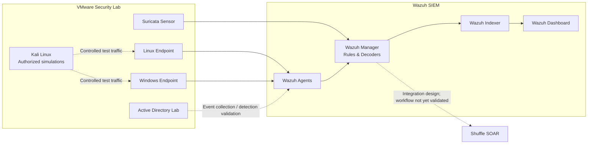

# Wazuh SIEM & Detection Engineering Lab

**A hands-on cybersecurity portfolio focused on SIEM operations, detection engineering, endpoint visibility, network monitoring, and incident investigation.**

This repository documents the design, configuration, controlled testing, and technical review of a VMware-based Wazuh lab. It brings together Linux and Windows telemetry, custom detection logic, File Integrity Monitoring (FIM), Suricata network monitoring, Active Directory security foundations, and a documented SOAR integration path.

> **Project transparency:** This is an engineering lab and an evolving portfolio. Each chapter distinguishes documented configuration, captured evidence, validated behavior, and work that remains pending. A configuration example is not presented as proof of a working detection.

## At a glance

| | |
|---|---|
| **Project type** | SIEM engineering and detection lab |
| **Core platform** | Wazuh Manager, Indexer, Dashboard, endpoint agents |
| **Environment** | VMware-based lab |
| **Operating systems** | Ubuntu Linux, Windows, Kali Linux for authorized simulations |
| **Network monitoring** | Suricata, EVE JSON, ET Open |
| **Detection engineering** | Wazuh rules, decoders, MITRE ATT&CK mapping |
| **Investigation** | Alert triage, event correlation, evidence handling |
| **Automation track** | Shuffle SOAR integration design; workflow validation pending |

## Lab architecture

The diagram shows the documented lab components and the intended integration path. Dashed connections represent work that is planned or still requires end-to-end validation.

## Technical coverage

| Area | Work documented | Evidence / validation position |
|---|---|---|
| **Wazuh deployment** | Manager services, dashboard, agent enrollment, deployment notes | Deployment documented; historical version and compatibility caveats retained |
| **Linux threat detection** | SSH authentication, privilege escalation, account and key persistence, cron activity, log tampering | Scenarios and custom rules documented; end-to-end validation is identified per detection |
| **Windows threat detection** | Security events, RDP logons, firewall telemetry, event collection | Configuration and test notes documented; rule IDs and telemetry must be verified against the installed ruleset |
| **Active Response** | RDP brute-force response design, temporary source blocking and rollback | Test procedure documented; source-IP matching and complete block/unblock behavior require evidence |
| **File Integrity Monitoring** | Linux sensitive paths; Windows Public-folder monitoring, who-data, change reporting | 13 Windows FIM screenshots retained in Chapter 04; staged experiment documented |
| **Suricata integration** | EVE JSON collection, ET Open, nine local signatures, traffic tests | 19 screenshots retained in Chapter 05; raw EVE-to-Wazuh alert pairs remain a useful evidence improvement |
| **Custom detection rules** | Linux and Windows rules, parent-rule dependencies, correlation design, MITRE mapping | Rule logic reviewed; version-specific and event-level validation requirements are documented |
| **Active Directory** | Domain security baseline, privileged group policy, Windows LAPS foundations, event-monitoring plan | AD foundation documented; dedicated Wazuh AD detection evidence remains pending |
| **Incident investigation** | Alert triage, event review, timeline, impact, response recommendations, case notes | Analyst workflow and evidence standards documented |
| **Shuffle SOAR** | Docker deployment notes, TheHive/Cassandra prerequisites, Wazuh integration template | Integration and workflow execution are not yet evidenced as operational |

## Skills and technologies

- **SIEM:** Wazuh Manager, Wazuh Indexer, Wazuh Dashboard
- **Detection engineering:** custom rules, rule dependencies, decoders, correlation, Sigma concepts
- **Endpoint monitoring:** Linux authentication logs, Windows Security events, Sysmon planning, FIM
- **Network security:** Suricata, EVE JSON, ET Open, traffic analysis
- **Incident response:** alert triage, investigation workflow, evidence review, Active Response safeguards
- **Identity security:** Active Directory, Group Policy, Fine-Grained Password Policies, Windows LAPS
- **Automation track:** Shuffle SOAR, webhook integration design, TheHive prerequisites
- **Lab and testing:** VMware, Ubuntu, Windows, Kali Linux, controlled attack simulation

## Repository guide

| Chapter | Topic |
|---|---|
| [01 — Wazuh Deployment](01-Wazuh-Deployment/README.md) | Platform deployment and agent setup |
| [02 — Linux Threat Detection](02-Linux-Threat-Detection/README.md) | Linux telemetry and authentication detections |
| [03 — Windows Threat Detection](03-Windows-Threat-Detection/README.md) | Windows event monitoring and RDP detections |
| [04 — File Integrity Monitoring](04-File-Integrity-Monitoring/README.md) | Linux and Windows FIM configuration and evidence |
| [05 — Wazuh and Suricata](05-Wazuh-Suricata-Integration/README.md) | Network telemetry and IDS integration |
| [06 — Custom Detection Rules](06-Custom-Detection-Rules/README.md) | Custom rules, dependencies, and validation |
| [07 — Active Directory Security](07-Active-Directory-Threat-Detection/README.md) | Domain policy and detection foundations |
| [08 — Incident Investigation](08-Incident-Investigation/README.md) | Alert triage and investigation methodology |
| [09 — Evidence and Documentation](09-Evidence-and-Documentation/README.md) | Evidence lifecycle and publication standards |
| [10 — Wazuh and Shuffle SOAR](10-Wazuh-Shuffle-SOAR/README.md) | SOAR deployment and integration design |

## Evidence and validation approach

For each scenario, the target evidence chain is:

1. Lab context and affected endpoint.
2. Relevant agent, manager, or sensor configuration.
3. Controlled test procedure and generated activity.
4. Original endpoint or sensor event.
5. Matching Wazuh alert, including timestamp, rule ID, agent, and decoded fields.
6. Validation output and observed response, where applicable.
7. Investigation notes, limitations, and conclusion.

Documentation uses explicit status labels such as **Documented**, **Evidence captured**, **Partially validated**, **Validated**, and **Pending**. Screenshots, raw logs, and alert records are described according to what they actually demonstrate.

## Safety, privacy, and reproducibility

- All attack simulations are intended for isolated systems owned by the operator or explicitly authorized for testing.
- Passwords and SSH private keys must not be published.
- Demonstration hash values may remain visible when they are part of controlled technical evidence.
- Lab IP addresses, MAC addresses, hostnames, usernames, timestamps, and other relevant technical details are retained where useful to reproduce and understand a scenario.
- Webhook URLs, API tokens, session cookies, and other credentials must remain out of Git.
- Review the exact Wazuh Manager and agent versions before reusing configuration or rule references.

## Version note

The source lab notes refer to Wazuh 4.7 / agent package 4.7.5. These are historical lab versions, not a recommendation for a new deployment. Verify compatibility and consult the documentation for the exact release in use.

## Project status and next validation priorities

The repository is structured and documented across ten chapters. The most valuable next evidence improvements are:

- Capture raw Suricata EVE events alongside their matching Wazuh alerts.
- Complete and capture the Active Directory event-to-alert validation chain.
- Verify Active Response source matching, block duration, and recovery.
- Capture a real Wazuh webhook delivery and Shuffle workflow execution before describing SOAR as operational.

---

**Maintainer:** [AFF-rgb](https://github.com/AFF-rgb)  
**Repository:** [Wazuh-SIEM-Detection-Engineering](https://github.com/AFF-rgb/Wazuh-SIEM-Detection-Engineering)
